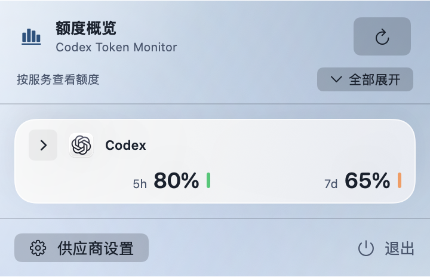
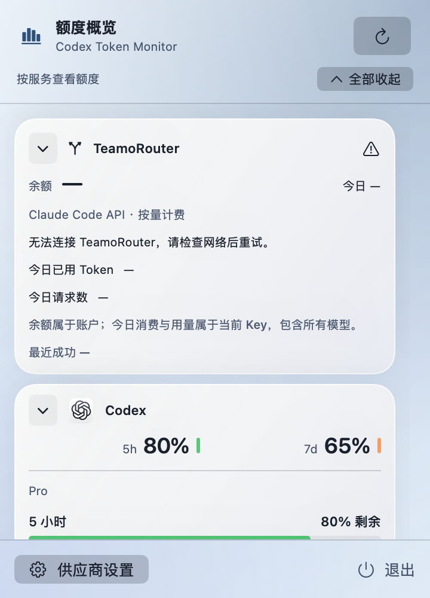
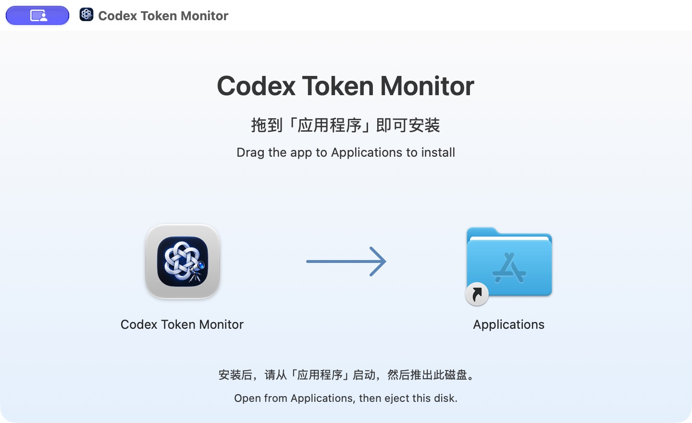

# Codex Token Monitor

<p align="center">
  
</p>

<p align="center">在菜单栏查看 AI 服务的剩余额度、余额与重置时间。</p>

Codex Token Monitor 是一个原生桌面额度监控工具。macOS 支持多供应商概览、自动轮播和本地通知；Windows 提供 Codex 系统托盘监控。数据直接从本机登录凭据对应的服务或官方 CLI 读取。

[下载最新版](https://github.com/Naja404/codex-token-monitor/releases/latest) · [使用指南](docs/usage.md) · [版本记录](https://github.com/Naja404/codex-token-monitor/releases) · [路线图](ROADMAP.md)

## 功能特性

- **多供应商监控**：Codex、Antigravity、Claude Code、Warp、TeamoRouter 分别展示，Gemini 4 Argon 独立额度不会与其他模型合并。
- **菜单栏常驻**：双行额度、重置时间、固定来源或自动轮播；Windows 在系统托盘显示 Codex 余量。
- **紧凑概览**：弹窗按内容自动调整高度，最多占所在屏幕可用高度的一半，超出部分滚动查看；可单独或全部展开明细。
- **稳定刷新**：查询中保留最近一次成功显示，相同结果不重复更新；失败、缺失数据和真实零额度分别处理。
- **可选本地通知**：按需选择低额度、额度恢复、刷新失败和登录失效提醒，支持阈值、声音与测试通知，默认关闭。
- **外观与语言**：四套主题，支持浅色、深色、跟随系统、减少动效，以及中文–简体和 English。
- **Touch Bar**：查看当前供应商额度、重置时间和刷新按钮，彩虹猫随剩余额度联动。
- **Codex 回写**：可选手动或定时向自建 API 回写 Codex 额度，自动回写默认关闭。
- **便捷安装与更新**：macOS 提供拖拽安装 DMG，App 内可查看版本并手动检查更新。

<p>
  
  
</p>

图片为使用隔离示例数据渲染的 macOS 原生视图，不包含真实账户信息。

## 支持的服务

| 服务 | 展示内容 | 连接方式 |
| --- | --- | --- |
| Codex | 5 小时、每周余量、重置时间及附加模型额度 | 本机 Codex 的 ChatGPT 登录凭据 |
| Antigravity | Gemini、Claude + GPT、Gemini 4 Argon 各自的额度 | 已安装并登录的官方 `agy` CLI |
| Claude Code | 官方订阅的 5 小时与每周余量 | 本机默认 OAuth 登录凭据 |
| Warp | 个人周期 Credits、重置时间与额外 Credits | 个人 `wk-…` API Key |
| TeamoRouter | USD 余额、今日消费、Token 用量与请求数 | API Key，可从 `.zshrc` 导入 |

macOS 支持表中的全部服务；Windows 当前支持 Codex。除 Codex 外，各供应商默认关闭，由用户验证连接后自行开启。订阅余量按百分比展示，Credits、金额和 Token 用量保留原单位，未知值显示 `—`。

## 安装

| 平台 | 下载 | 要求 |
| --- | --- | --- |
| macOS | [DMG 拖拽安装器](https://github.com/Naja404/codex-token-monitor/releases/latest/download/Codex-Token-Monitor-macOS-arm64.dmg) · [ZIP](https://github.com/Naja404/codex-token-monitor/releases/latest/download/Codex-Token-Monitor-macOS-arm64.zip) | Apple Silicon，macOS 14+ |
| Windows | [Windows x64 ZIP](https://github.com/Naja404/codex-token-monitor/releases/latest/download/Codex-Token-Monitor-Windows-x64.zip) | Windows 10/11 x64，自带运行时 |

macOS 正式包使用 Developer ID 签名并通过 Apple 公证；Windows EXE 尚未进行代码签名。校验文件见 [SHA256SUMS.txt](https://github.com/Naja404/codex-token-monitor/releases/latest/download/SHA256SUMS.txt)。

### macOS

1. 下载并打开 DMG；升级时先退出旧版应用。
2. 将 App 拖入右侧 Applications，完成后推出磁盘。
3. 从“应用程序”打开，在本机登录 Codex 后查看菜单栏额度。



### Windows

1. 在 Windows 本机使用 ChatGPT 账号登录 Codex。
2. 解压 ZIP，运行 `CodexTokenMonitor.exe`。
3. 点击托盘图标查看额度，右键菜单可刷新、配置回写或退出。

Windows 的配置、构建及验收说明见 [Windows 使用说明](windows/README.md)。

## 开始使用

在菜单栏弹窗中打开 **供应商设置 → 服务与账号**，连接并启用需要的供应商；在 **菜单栏与显示** 选择固定来源或自动轮播。

需要提醒时，进入 **通知** 选择类别和阈值，开启总开关并允许 macOS 通知权限，再发送测试通知。通知要求应用保持运行，显示方式由系统通知设置和专注模式决定。

在 **关于与更新** 查看当前版本、项目地址并手动检查更新。供应商连接步骤、快捷键、通知规则、Touch Bar 和回写配置见 [使用指南](docs/usage.md)。

## 数据与隐私

- 直接查询已启用服务的额度接口或官方 CLI，不读取或上传提示词、聊天内容和项目代码。
- Codex 使用本机登录凭据；Warp 和 TeamoRouter 密钥存放在 macOS 钥匙串。应用不修改供应商登录凭据。
- 显示偏好和通知去重状态保存在本机；本地通知不接入远程推送服务器。
- 回写仅在用户配置后发送 Codex 额度。macOS 回写 Bearer 当前保存在 UserDefaults，Windows 使用当前用户 DPAPI 加密。

## 当前范围

- 部分服务使用客户端内部额度接口，服务端变化可能影响读取；不支持任意代理、多账号管理或历史趋势。
- Codex 额度是订阅余量，不是 OpenAI API Key 余额；Claude Code OAuth 订阅和第三方 API Key 使用不同连接方式。
- macOS 与 Windows 的功能范围不同；真实账号、Touch Bar 硬件及 Windows 桌面交互的验收范围见 [路线图](ROADMAP.md#待验证)。

## 从源码运行

```bash
git clone https://github.com/Naja404/codex-token-monitor.git
cd codex-token-monitor
```

macOS 需要 Swift 6 与 Xcode Command Line Tools：

```bash
swift run
swift test
swift build -c release
```

`swift run` 启动后常驻菜单栏，在终端按 Ctrl+C 退出。修改源码后请先退出旧进程，再重新运行。

Windows 需要 .NET 10 SDK：

```bash
dotnet run --project windows/Checks -c Release
dotnet run --project windows/App -c Release
```

## 文档

- [使用指南](docs/usage.md)：供应商连接、通知、快捷键、Touch Bar 和回写配置。
- [版本记录](https://github.com/Naja404/codex-token-monitor/releases)：每次发布的变更与安装包。
- [产品路线图](ROADMAP.md)：实现范围、验证状态及后续计划。
- [macOS 打包与签名](docs/macos-packaging.md)：安装器构建、Developer ID 签名和公证流程。
- [品牌资源来源](docs/provider-logo-sources.md)。

## License

[MIT License](LICENSE) © 2026 Naja404。
