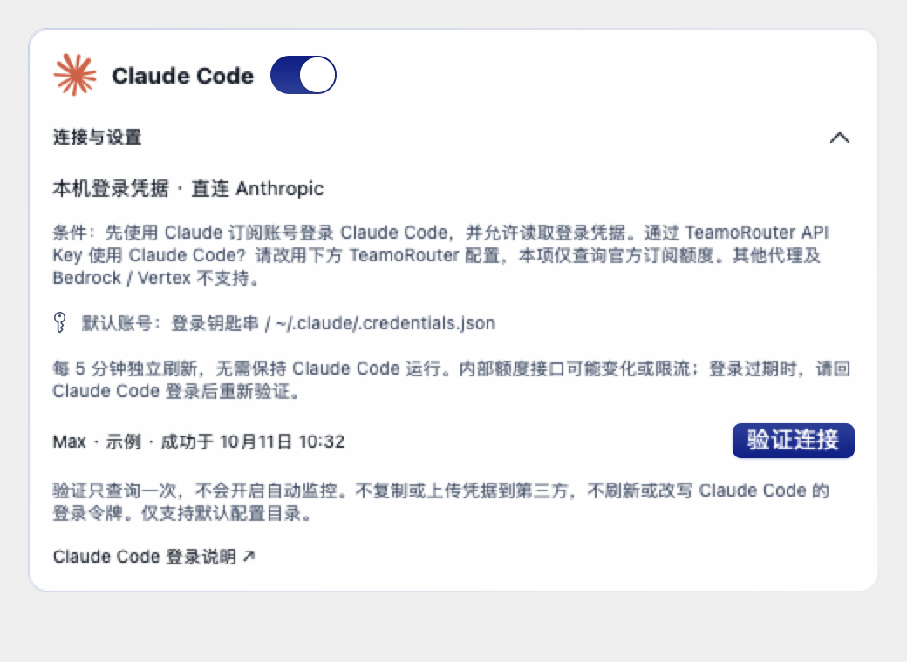
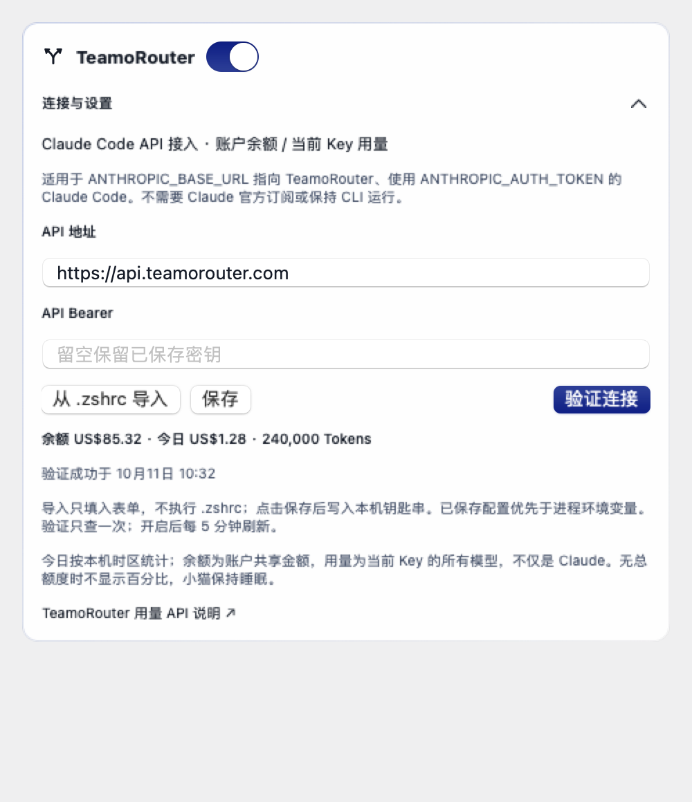
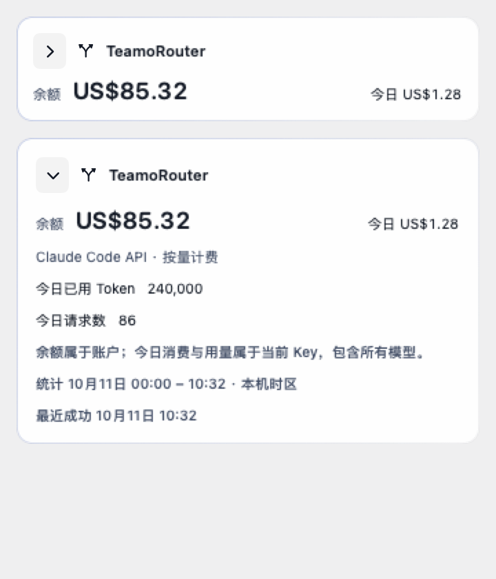
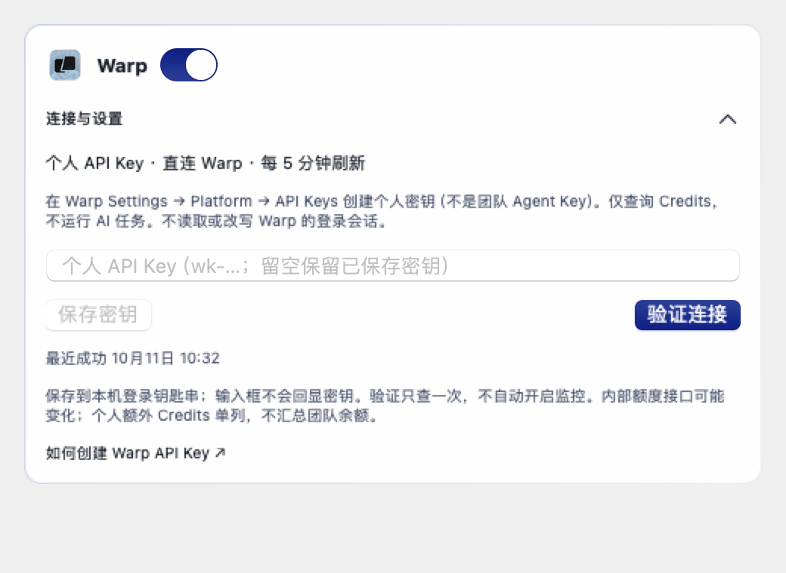
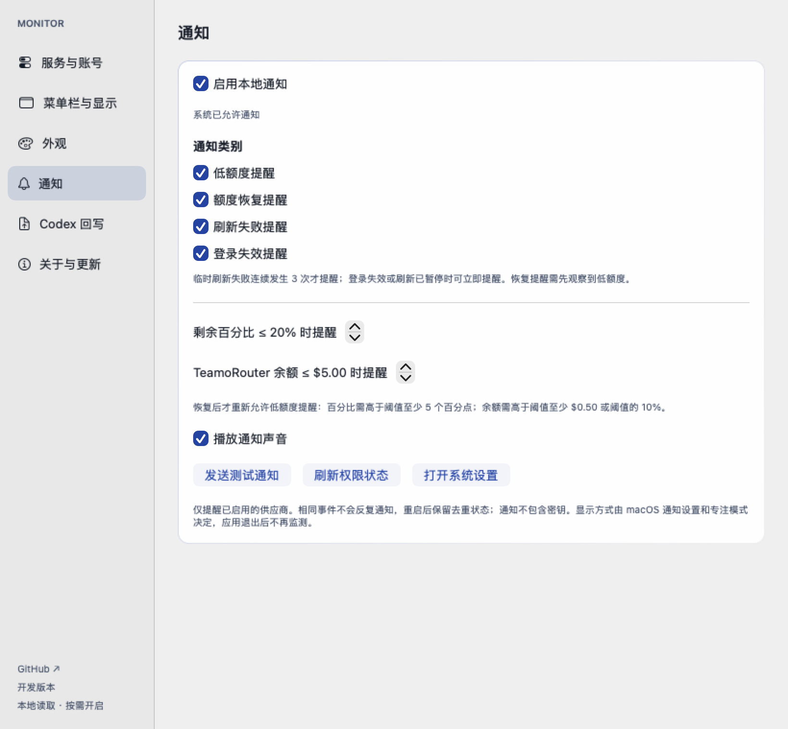

# 使用指南

[返回项目介绍](../README.md)

## 服务与账号（macOS）

同一概览中按供应商展示额度，不合并不同服务、不同模型组的百分比。Codex / Antigravity / Claude 为订阅剩余比例，不是精确 token 数；Warp 按接口返回的 Credits 和周期上限展示；TeamoRouter 展示账户美元余额和当前 Key 的消费、Token 用量，不转换成百分比。

| 供应商 | 读取方式与条件 | 默认开关 / 刷新 |
| --- | --- | --- |
| Codex | 本机 `auth.json` 中有效的 ChatGPT 登录凭据，直连 OpenAI 额度接口 | 开启 / 30 秒 |
| Antigravity | 官方 `agy` CLI ≥ 1.1.11，已在 CLI 登录且账号能使用 `/usage` | 关闭 / 开启后约 60 秒 |
| Claude Code | 默认配置的 Claude 订阅 OAuth 登录；只读本机钥匙串或 `.claude/.credentials.json`，直连 Anthropic 额度接口 | 关闭 / 开启后约 5 分钟 |
| Warp | 在设置中保存个人 `wk-…` API Key 到 macOS 钥匙串，直连 Warp GraphQL；无需 CLI 常驻 | 关闭 / 开启后约 5 分钟 |
| TeamoRouter（Claude Code API） | 从 `~/.zshrc` 导入或手动填写根地址与 `ANTHROPIC_AUTH_TOKEN`，保存到本机钥匙串；也支持进程环境变量 | 关闭 / 开启后约 5 分钟 |

### 开启 Antigravity

1. 按 [Antigravity 官方 CLI 文档](https://antigravity.google/docs/cli/commands/usage) 安装并登录；先在终端确认 `agy --version` 和 `agy -p /usage --output-format json --print-timeout 20s` 可用。
2. 运行本项目，点击菜单栏 → **供应商设置 → 服务与账号**。
3. 在 Antigravity 卡片中检查检测结果。若没有找到 CLI，使用“选择文件…”或填写可执行文件绝对路径，再点“保存路径”。留空时扫描 PATH 和常见安装位置；从 Finder 启动的 App 不一定继承终端的 PATH。
4. 点击“验证连接”。这是一次只读额度查询，不会自动打开监控开关；成功后按需开启 Antigravity。
5. 在“菜单栏与显示”选择“固定显示”或“自动轮播”。可选已开启的 Codex、Antigravity · Gemini、Antigravity · Claude + GPT、Claude Code、Warp 或 TeamoRouter；自动轮播按顺序展示额度组，可设 **5–60 秒**间隔（默认 10 秒）。设置自动保存；关闭轮播后回到所选固定来源。

当 CLI 返回 `Gemini 4 Argon` 独立额度组时，概览及固定显示 / 自动轮播会增加 **Antigravity · Gemini 4 Argon**（菜单前缀 `G4`）。`gemini-argon-wtu-weekly` 与普通 Gemini、Claude + GPT 分别展示；当前 CLI 只提供 Argon 每周额度，不推算 5 小时额度。没有独立 Argon 组的账号不会增加空的轮播项。

### 开启 Claude Code（官方订阅）

如果 Claude Code 使用 TeamoRouter 的环境变量 API Key，请使用下方独立的 **TeamoRouter** 配置，而不是本项 OAuth 订阅开关。

1. 按 [Claude Code 官方登录说明](https://code.claude.com/docs/en/authentication) 使用 Claude 订阅账号登录，而非 API Key 或第三方代理。只安装 CLI 不代表已具备订阅 OAuth 凭据。
2. 打开 **供应商设置 → 服务与账号 → Claude Code → 验证连接**。必要时 macOS 会要求允许读取登录钥匙串；后台自动刷新不会主动请求授权。
3. 验证成功后开启 Claude Code 开关；默认关闭，验证一次不会自动启用轮询。无需保持 Claude Code 运行，但登录令牌过期后需在官方客户端重新登录。
4. 在“菜单栏与显示”选择 Claude Code 或开启轮播。`CL` 表示 Claude Code，`C+G` 表示 Antigravity 内的 Claude + GPT，二者不是同一份额度。Touch Bar 同步显示当前来源，小猫仍按该来源两个窗口中较低余量联动。

读取路径：只读默认登录钥匙串的 `Claude Code-credentials` 项；不存在时读取 `~/.claude/.credentials.json` 的 `claudeAiOauth`。不扫描其他钥匙串项目、不存储令牌副本、不修改/刷新登录令牌；当前不支持自定义 `CLAUDE_CONFIG_DIR` 和多账号切换。API Key、Bedrock、Vertex 或代理额度不适用。

请求固定为 `GET https://api.anthropic.com/api/oauth/usage`，携带 OAuth Bearer 与 `anthropic-beta: oauth-2025-04-20`，禁止重定向。读取账户级 `five_hour` / `seven_day` 的 `utilization`，计算 `100 - utilization` 得到剩余百分比；不混入模型专用额度。`resets_at` 转为系统时区日期，未知值显示 `—`。

这是**客户端内部接口，不是 Anthropic 承诺稳定的公共 API**；其社区问题记录包含该端点的请求方式及限流报告，见 [Anthropic 仓库 issue #30930](https://github.com/anthropics/claude-code/issues/30930)。默认 5 分钟查询一次，失败退避最长 1 小时；服务端 `Retry-After` 更长时优先遵守。限流期间手动刷新和开关切换也不会立即重试；401/403、登录缺失或钥匙串访问受限时暂停自动查询，修复后手动验证。

下面是 Claude 设置卡片的原生界面预览，使用测试示例数据：



### 开启 TeamoRouter（兼容 Claude Code 环境变量 API Key）

1. 打开 **供应商设置 → 服务与账号 → TeamoRouter**，点击“从 .zshrc 导入”。只读取 `~/.zshrc` 中顶层、单行的 `ANTHROPIC_BASE_URL` 和 `ANTHROPIC_AUTH_TOKEN` 字面量赋值；支持 `export`、单双引号和行尾注释。不执行或修改脚本，不展开变量、不运行命令替换、不追踪 `source`；复杂配置请手动填写。
2. 导入只填入表单，密钥使用安全输入框隐藏。确认 API 地址后点击“保存”，再点“验证连接”。地址和密钥一起存入本应用的 `CodexTokenMonitor.TeamoRouter` 钥匙串项；密钥不进入 UserDefaults、日志、截图或仓库。后台读取不会主动弹授权框。
3. 验证成功后按需开启开关，每 5 分钟刷新。验证本身不会开启自动监控。已保存配置优先；没有保存配置时可使用当前进程的两个环境变量。从 Finder 启动的 `.app` 通常不继承 `.zshrc`，因此推荐导入并保存。
4. 菜单栏选择 TeamoRouter（`TR`）或轮播：第一行账户余额，第二行今日消费。明细显示今日已用 Token、请求数、统计区间和最近成功时间。Touch Bar 同步显示金额；没有总额度分母，不计算百分比，小猫保持睡眠。

按 [TeamoRouter 官方 API 文档](https://api.teamorouter.com/docs/open-api)，使用 Bearer 只读请求：

| 接口 | 展示内容 / 范围 |
| --- | --- |
| `GET /v1/billing/balance` | 当前 Key 所属账户的共享 USD 余额 |
| `GET /v1/billing/costs?start_time=…&end_time=…` | 当前 Key 的今日消费 |
| `GET /v1/usage?start_time=…&end_time=…` | 当前 Key 的今日 Token 用量和请求数 |

“今日”从本机时区的零点起算，消费和用量查询使用相同时间边界，包含该 Key 调用的所有模型，不保证仅来自 Claude Code。API 根地址仅接受 `https://api.teamorouter.com` 或 `https://teamorouter.com`，禁止 HTTP 和重定向；第三方密钥不会发送给 Anthropic。错误不当作零余额；401/403 或缺失凭据暂停自动查询，429 遵守 `Retry-After`，其他失败退避至最长 1 小时。不会执行模型请求、购买余额、改变 Claude 登录状态，也不会把此数据回写到 Codex 回写接口。

可运行 `TEAMO_LIVE_CHECK=1 swift test --filter teamoLiveReadFromZshrc` 做只读验证（仅输出查询汇总，不输出密钥；不会保存或开启配置）。




### 开启 Warp

1. 按 [Warp 官方 API Key 文档](https://docs.warp.dev/agents/cli/oz-cli/api-keys/) 创建**个人 API Key**（`wk-…`），不要使用团队 Agent Key。
2. 在 **供应商设置 → 服务与账号 → Warp** 输入密钥，点击“保存密钥”，再点击“验证连接”。密钥只存入本应用专用 macOS 钥匙串项，不存入 UserDefaults，不回显到输入框，也不写日志。
3. 验证成功后按需开启。验证一次不会自动启用监控；开启后约每 5 分钟刷新，无需保持 Warp 或 CLI 运行。
4. 菜单栏选择 Warp 或开启轮播；两行显示周期剩余 Credits 和重置日期，Touch Bar 同步显示周期与个人额外 Credits。

请求固定为 `POST https://app.warp.dev/graphql/v2?op=GetRequestLimitInfo`，通过 Bearer 鉴权执行只读 GraphQL 查询并禁止重定向。这是 **Warp 客户端内部额度接口，不保证长期稳定**。协议参考 [CodexBar 的 Warp 实现](https://github.com/steipete/CodexBar/blob/main/Sources/CodexBarCore/Providers/Warp/WarpUsageFetcher.swift)，本项目独立实现解析与安全边界。

周期剩余量为 `max(0, requestLimit - requestsUsedSinceLastRefresh)`；有效上限 >0 才计算百分比。无上限明确标记，缺失数据为 `—`，不伪造 5 小时 / 每周窗口。只统计个人 `bonusGrants` 的未过期 Credits，不请求或汇总工作区余额；此接入不支持团队额度。限流遵守 `Retry-After`（包括手动验证和开关切换），失败退避最长 1 小时；401/403 或缺少密钥时暂停自动查询。

**验证边界：当前已完成离线解析、状态、界面和 Touch Bar 测试；尚未用真实 Warp 个人 API Key 完成端到端验证。** 本应用不读取或刷新 Warp 私有登录会话，请在设置中输入密钥，不要把密钥发到 issue 或聊天里。



## 菜单与弹窗

在“菜单栏与显示”选择固定来源或自动轮播；轮播仅切换已读取数据，不增加请求频率，弹窗打开期间暂停轮播。弹窗按实际内容调整高度，上限为所在屏幕可用高度的一半；额度卡片超出后滚动，标题和底部按钮保持可见。每次打开默认折叠，点击卡片箭头或“全部展开”查看详情。

界面语言可选中文–简体和 English。外观提供原生、极光、石墨和玻璃四套主题，支持浅色、深色、跟随系统和关闭动效；系统辅助功能设置优先。

## 本地通知

1. 打开设置 → **通知**，勾选希望收到的类别：低额度、额度恢复、刷新失败、登录失效。四类可以独立选择；默认只有低额度类别预选，通知总开关仍为关闭。
2. 按需设置剩余百分比（默认 ≤20%）、TeamoRouter 美元余额（默认 ≤$5）及声音，再开启“启用本地通知”，允许 macOS 的权限提示。
3. 点击“发送测试通知”。若系统未允许通知，打开系统设置 → 通知 → Codex Token Monitor；通知样式、声音及专注模式由 macOS 控制。

只检查已启用供应商的本次成功数据，菜单缓存、等待中、缺失数据和错误均不当作零额度。相同低额度不会反复提醒；百分比恢复到阈值以上至少 5 个百分点，或余额恢复到阈值以上至少 $0.50 / 阈值的 10%（取较大值）后，才重新允许提醒。恢复通知需先观察到低额度。临时刷新失败需连续 3 次已完成的失败读取才提醒；登录或密钥异常及已暂停的读取可立即提醒，每次故障只提醒一次，成功读取后重置。

通知使用 macOS 本地服务，不接入远程推送服务器、不发送密钥；点击通知可返回设置。通知总开关、类别、阈值及去重状态保存在本机。应用需保持运行，退出后不再监测，也不会额外增加供应商查询频率。



图片为隔离测试配置的原生视图预览，展示全部类别可选；不代表默认开启或系统已实际授权，不含真实账户信息。

## 检查更新

设置 → 关于与更新可查看项目地址和当前版本，手动检查更新。默认只检查正式版，可选择包含预发布版本；发现更新后打开对应发布页下载并安装。

## macOS 快捷键

| 操作 | 快捷键 |
| --- | --- |
| 粘贴 / 拷贝 / 剪切 | Cmd+V / Cmd+C / Cmd+X |
| 全选 / 撤销 / 重做 | Cmd+A / Cmd+Z / Cmd+Shift+Z |
| 关闭当前窗口 / 最小化 | Cmd+W / Cmd+M |
| 退出监控器 | Cmd+Q |

无需额外开启系统选项。文本编辑作用于当前输入框；密钥输入框支持粘贴和全选，仍禁止复制或剪切密钥。关闭设置窗口不会退出菜单栏监控。菜单名称随应用的中英文设置切换。

## Codex 回写

macOS 在“供应商设置 → Codex 回写”中配置；Windows 使用托盘菜单中的回写设置入口。填写 API 地址、Bearer 和 Codex Key ID，再点击“保存配置”。“验证连接”会发送一次当前 Codex 额度请求确认接口和凭据有效；“立即回写”用于手动发送。应用使用 `POST` 请求并发送以下 JSON（Bearer 只放在 `Authorization` 请求头，不会进入 body）：

```json
{
  "codex_key_id": "codex-8761b8cc2e114f59",
  "five_hour": {
    "remaining_percent": 27,
    "reset_time": "20:50"
  },
  "seven_day": {
    "remaining_percent": 82,
    "reset_date": "9月6日 16:48"
  }
}
```

## Touch Bar

带 Touch Bar 的 MacBook Pro 可在弹窗或设置窗口激活时查看当前供应商额度、重置时间和刷新按钮。小猫按两个有效窗口中较低的剩余比例联动；没有可计算百分比时熟睡。离开应用或关闭动效后停止动画。

| 剩余比例 | 动作 |
| --- | --- |
| ≥80% | 快跑 |
| 50–79% | 小跑 |
| 20–49% | 慢走 |
| 10–19% | 打盹 |
| <10% 或无有效数据 | 熟睡 |

如果系统仅显示功能键或展开的控制条，请在系统设置 → 键盘 → Touch Bar 设置中选择 App 控制。没有 Touch Bar 的 Mac 使用菜单栏功能。
